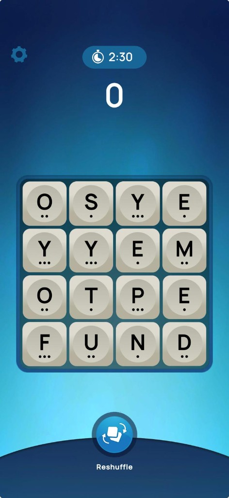

<div align="center">

# WordLink Solver

**Turn a 4x4 word-board screenshot into ranked, visualized solutions.**

<p>
  A local Python application that reads a Word Link board, searches every valid path, ranks the results,
  and displays the winning route on an interactive web interface.
</p>

[](https://www.python.org/)
[](https://fastapi.tiangolo.com/)
[](https://opencv.org/)
[](https://numpy.org/)
[](https://github.com/doronz88/pymobiledevice3)

</div>

## Project Preview

The repository includes a labeled reference screenshot at
[`word_solver/vision/samples/board_osye.jpg`](word_solver/vision/samples/board_osye.jpg).
It is used as an end-to-end vision test and represents the board:

```text
O  S  Y  E
Y  Y  E  M
O  T  P  E
F  U  N  D
```

<p align="center">
  
</p>

> The repository does not currently contain a screenshot or GIF of the interactive web interface.
> A UI capture is a useful next visual asset: show the current best word, numbered path overlay,
> next-word preview, and red flagged-tile treatment after one solve.

<details>
<summary><strong>More preview ideas</strong></summary>

- Short GIF of an iPhone board changing, settling, and updating the recommendation.
- Screenshot of manual board entry and tile correction.
- Screenshot of vision debug output showing board, cell, glyph, and confidence data.
- Screenshot of the CLI report for the reference board.

</details>

## What It Does

WordLink Solver supports five input paths:

1. Upload or paste a screenshot in the web UI.
2. Drag a screenshot onto the page.
3. Enter a board manually.
4. Edit individual recognized tiles.
5. Watch a paired iPhone over USB and solve each stable board automatically.

The solver:

- Locates the 4x4 board and extracts all 16 tiles.
- Isolates each dark letter, normalizes it, and compares it to letter templates.
- Flags low-confidence or ambiguous tiles instead of silently trusting a bad reading.
- Searches adjacent and diagonal moves on a 4x4 grid without reusing a tile.
- Supports a `QU` tile as two letter positions.
- Ranks every valid word by Scrabble-style letter points plus a length bonus.
- Displays the selected word as a numbered, colored route over the board.
- Remembers rejected words in `blocked_words.txt` and can undo the latest rejection.

## Key Features

| Feature | Implementation |
|---|---|
| Automatic iPhone capture | Read-only `pymobiledevice3` USB/DVT screenshot session |
| Board-change detection | Compares only the configured board crop and waits for stable frames |
| 4x4 board detection | Normalized coordinates with OpenCV tile refinement and fallback |
| Letter recognition | Binary glyph extraction plus normalized template correlation |
| Confidence safeguards | Minimum confidence and runner-up margin thresholds mark uncertain tiles |
| Efficient word search | Per-board DFS over an 8-direction neighbor graph |
| Dictionary pruning | Trie prefixes eliminate branches with no possible dictionary word |
| Top results | Score ranking, then word length, then alphabetic tie-breaking |
| Interactive visualization | Web board with start/middle/end colors, numbered steps, arrows, and path lines |
| Manual correction | Edit mode and per-tile dialog, including `Q` versus `QU` handling |
| Rejected-word management | Append-only persistent block list plus in-session undo |
| Alternative suggestions | Skip a word without blocking it or re-running recognition |

## How It Works

```mermaid
flowchart LR
    I[iPhone or screenshot] --> C[Capture or upload]
    C --> D[Board change settling]
    D --> R[Locate 4x4 board]
    R --> G[Split 16 cells]
    G --> L[Isolate and normalize glyphs]
    L --> T[Template matching and confidence]
    T --> B[Board state]
    B --> TR[Build or load Trie dictionary]
    TR --> DFS[DFS from every tile]
    DFS --> RK[Score and rank words]
    RK --> UI[FastAPI state and web board]
    UI --> W[Top word and numbered path]
```



### Vision pipeline

1. The configured board rectangle is scaled from normalized fractions of the screenshot width and height.
2. Optional refinement searches a margin around that rectangle for light, low-saturation, tile-sized blobs.
3. If exactly 16 tile blobs are found, the board snaps to their combined bounding box; otherwise it uses the configured rectangle.
4. The board is divided into a 4x4 cell grid. A reduced letter region excludes most of the dot row.
5. Each region is grayscale-thresholded, connected-component filtered, tightly cropped, and normalized to a 32x32 white-on-black glyph.
6. `TemplateMatchRecognizer` uses normalized cross-correlation against real samples first, then synthetic font templates.
7. A cell is flagged when its score is below the configured confidence threshold or too close to the runner-up.

### Trie and DFS

The dictionary is converted into a Trie. DFS begins at every tile and follows orthogonal and diagonal neighbors.
Before entering a neighboring tile, the solver advances the current Trie node by that tile's letters.
A missing child proves that no dictionary word can continue with that prefix, so that branch is pruned immediately.

The 4x4 search also uses:

- A board-wide neighbor list built once per solver.
- A bitmask of visited tiles to prevent reuse in the same path.
- Multi-letter tile support for `QU`.
- Minimum and maximum word-length checks.
- Duplicate removal while discovering paths.

### Ranking and recommendations

Each word receives:

- Scrabble-style points for each letter.
- A length bonus: 100 for 4 letters, 250 for 5, 500 for 6, and 1000 for 7 or more.

Results are sorted as:

1. Highest total score.
2. Longer word as the tie-breaker.
3. Alphabetical order.

The CLI and manual report expose the top 10. The web service caches the ranked board result, presents the current
word first, and exposes alternatives after it. Rejecting or skipping a word changes only the suggestion index:
it does not capture, recognize, or solve the board again.

## Technology Stack

| Area | Technology | Role |
|---|---|---|
| Language | Python | Solver, vision, API, and capture pipeline |
| Backend | FastAPI / Uvicorn | Local HTTP API and static web serving |
| Frontend | HTML, CSS, JavaScript | Board UI, SVG path overlay, file/drop/paste input |
| Computer vision | OpenCV | Tile detection, thresholding, contours, template matching |
| Arrays | NumPy | Image representation and pixel operations |
| Templates | Pillow | Font-rendered synthetic fallback glyph generation |
| iPhone | pymobiledevice3 | USB pairing, Developer Mode/DDI checks, read-only screenshots |
| Testing | `unittest`, httpx | Solver, vision, capture, web, rejection, and path tests |
| Dictionary | ENABLE1 + frequency ranking | Frequency-filtered base dictionary generation |

## Installation and Setup

### Prerequisites

- Windows
- Python 3.10 or newer
- A data-capable USB cable
- An iPhone, unlocked and able to approve the Trust pairing prompt
- Apple Mobile Device support from iTunes/Apple Devices or the Apple USB components

For screenshot-only use, OpenCV and NumPy are sufficient. Live iPhone capture additionally requires
`pymobiledevice3`, which is included in `requirements.txt`.

### Clone and install

```powershell
git clone https://github.com/arnavdedhia/WordLink.git
cd WordLink

py -3 -m venv .venv
.\.venv\Scripts\Activate.ps1
python -m pip install --upgrade pip
python -m pip install -r requirements.txt
```

If PowerShell blocks virtual-environment activation, run:

```powershell
Set-ExecutionPolicy -Scope Process -ExecutionPolicy Bypass
.\.venv\Scripts\Activate.ps1
```

No `.env` file or environment variable is required.

### Prepare the iPhone

Start by checking USB detection:

```powershell
python -m word_solver.capture list
```

Pair once:

```powershell
python -m word_solver.capture pair
```

Unlock the iPhone and tap **Trust** if prompted.

Prepare Developer Mode and the Developer Disk Image:

```powershell
python -m word_solver.capture prepare
```

The iPhone may reboot. iOS 17.4 and newer generally uses an in-process RSD tunnel.
iOS 17.0-17.3.1 on Windows may require administrator-run `tunneld`.
The CLI reports the exact issue.

Capture and save one test screenshot:

```powershell
python -m word_solver.capture screenshot --out word_solver/capture/captures/iphone.png
python -m word_solver.capture doctor
```

On Python 3.14, `pymobiledevice3` notes a possible `pyimg4`/`pylzss` build-tool requirement.
Screenshot capture does not import `pyimg4`, but Developer Disk Image mounting can.
Microsoft C++ Build Tools may be required if the `prepare` command reports that the mounter is unavailable.

### Start the web app

```powershell
python -m word_solver.web --open
```

Open `http://127.0.0.1:8000` if `--open` cannot open a browser.

To run the local server without attempting iPhone capture:

```powershell
python -m word_solver.web --no-iphone --open
```

### Start through the CLI

Solve a manual board:

```powershell
python -m word_solver --board OSYE YYEM OTPE FUND
```

Solve the included reference screenshot:

```powershell
python -m word_solver --image word_solver/vision/samples/board_osye.jpg --debug
```

## Usage

### Web workflow

1. Start the web app.
2. Choose a screenshot, drag it onto the page, paste it with `Ctrl+V`, or use **Type board**.
3. Review the 4x4 board and low-confidence warnings.
4. Use **Edit letters** or tap a flagged tile to confirm or correct a recognition.
5. Read the current best word and follow its numbered tiles on the board.
6. Press `X` or **WORD NOT ACCEPTED** to persist a rejection and advance.
7. Press `N` or **NEXT WORD** to skip a suggestion without blocking it.
8. Press `Z` or **Undo Last Rejection** to remove the latest block.

### Automatic iPhone workflow

1. Unlock and connect the iPhone.
2. Complete `pair` and `prepare` once where required.
3. Start the web app.
4. Click **Watch iPhone**.
5. Leave the game board visible. Capture checks the board crop repeatedly.
6. Falling or changing frames enter a settling state.
7. After several near-identical frames, the app captures, recognizes, solves, and refreshes the UI.
8. If the device disconnects or recognition fails, the last known board remains visible and is marked stale.

### Rejected and allowed words

```text
word_solver/data/triumph_words.txt  # frequency-filtered base dictionary
word_solver/data/allowed_words.txt  # words confirmed in-game
word_solver/data/blocked_words.txt  # words that should never be recommended
```

Final dictionary = base + allowed - blocked.

```powershell
python -m word_solver --allow FOOBAR
python -m word_solver --block YOYO
```

## Technical Highlights

- **Read-only capture:** the iPhone integration never sends touches or HID input.
- **Board-specific change detection:** score and timer chrome are outside the board crop and do not trigger solves.
- **Stable-frame debounce:** new boards require repeated low-difference frames before recognition begins.
- **Trie prefix pruning:** each failed Trie child lookup abandons an entire dictionary branch.
- **Bitmask visitation:** prevents tile reuse without allocating a visited set for every DFS call.
- **Cached web state:** the solver result is retained; reject/next operations switch indexes rather than recompute.
- **Cold-start safety:** if no board is loaded or recognition is uncertain, the UI reports a solve error or warning.
- **Swap-ready vision:** letter recognition is behind a `LetterRecognizer` interface.
- **Template learning:** real labeled samples override synthetic templates for any letter that has samples.
- **Debugging:** debug runs save original, board crop, annotated image, 16 tile crops, 16 glyph/crop files, and text/JSON reports.
- **No application secret configuration:** the system is designed to operate locally with files and USB devices.

<details>
<summary><strong>Scoring example</strong></summary>

The reference `DEPUTES` result is based on the repository's letter values and length bonus:

```text
Letter points + length bonus = score
10             + 1000         = 1010
```

This is one actual result covered by the web tests for the reference board.

</details>

## Project Structure

```text
WordLink/
├── README.md
├── requirements.txt
├── scripts/
│   └── build_dictionary.py       Frequency-filtered dictionary generator
├── word_solver/
│   ├── config.py                 Board, scoring, and file configuration
│   ├── dictionary.py             Dictionary loading and allow/block persistence
│   ├── trie.py                   Prefix Trie implementation
│   ├── solver.py                 DFS, ranking, paths, and solver timing
│   ├── main.py                   CLI entry point
│   ├── capture/
│   │   ├── iphone_capture.py     Read-only pymobiledevice3 integration
│   │   ├── capture_manager.py    Capture loop, settling, stale-state handling
│   │   └── change_detector.py    Board-crop stability detection
│   ├── vision/
│   │   ├── pipeline.py           Screenshot-to-reading orchestration
│   │   ├── board_detector.py     Board rectangle and 16-cell splitting
│   │   ├── board_reader.py       Glyph extraction and recognition state
│   │   ├── letter_recognizer.py  Template matching and confidence
│   │   ├── templates.py          Sample/synthetic template library
│   │   └── samples/              Labeled reference screenshot
│   ├── web/
│   │   ├── app.py                FastAPI routes and live capture attachment
│   │   ├── service.py            Board cache, solving, reject/next/undo state
│   │   └── static/               HTML, CSS, JavaScript, and SVG rendering
│   ├── data/
│   │   ├── triumph_words.txt     50,000-word filtered base dictionary
│   │   ├── allowed_words.txt     Confirmed-word exceptions
│   │   └── blocked_words.txt     Persisted rejected words
│   └── tests/                    Unit and integration test suite
```

## Dictionary Generation

The repository currently ships `triumph_words.txt` with 50,000 base entries.
The generator downloads a frequency list and ranks the 3-16 letter subset of ENABLE1.
It caches the downloaded frequency file at `word_solver/data/.cache/`.

```powershell
python scripts/build_dictionary.py
python scripts/build_dictionary.py --size 85000
```

The frequency and inflection options are implemented by the script. This regeneration step is optional;
normal app setup uses the committed dictionary file.

## Tests

Run the suite from the repository root:

```powershell
python -m unittest discover -s word_solver/tests -t .
```

The tests cover:

- Trie insertion and prefix behavior
- DFS paths and coordinate correctness
- Ranking and scoring
- Board and letter recognition
- Template fallback and sample precedence
- iPhone-change detection and capture failures
- FastAPI upload/manual/correction flows
- Rejection persistence and undo behavior

## Limitations and Future Improvements

Known current limitations:

- Board geometry is designed for a specific screenshot layout; different resolutions are handled but major UI layout changes may require normalized-config tuning.
- Board refinement and glyph recognition are template-based rather than a trained ML model.
- The live capture path is read-only and currently targeted at Windows USB iPhone support.
- The web UI uses a fixed 4x4 board.
- Rejected words persist as an append-only block file, but the undo stack lasts only for the current process.
- No license file is currently present.

Realistic improvements:

- Replace or augment template matching with a trained OCR model.
- Detect the board dynamically instead of relying mostly on normalized geometry.
- Improve UI and video previews for responsive devices and different screens.
- Add a board-history or statistics view.
- Add configuration validation and a setup screen for template confidence thresholds.
- Support screenshot rotation and additional game layouts.
- Package the app with a Windows launcher or installer.

## Credits and License

### Dictionary sources

- The base word list is `ENABLE1`, loaded by `scripts/build_dictionary.py`.
- Frequency ranking uses the OpenSubtitles 2018 English list from
  [hermitdave/FrequencyWords](https://github.com/hermitdave/FrequencyWords).
- Runtime output uses `triumph_words.txt`, `allowed_words.txt`, and `blocked_words.txt` under `word_solver/data/`.

### Libraries

- [OpenCV](https://opencv.org/) for image processing and template matching
- [NumPy](https://numpy.org/) for image arrays
- [Pillow](https://python-pillow.org/) for synthetic template rendering
- [FastAPI](https://fastapi.tiangolo.com/) and [Uvicorn](https://www.uvicorn.org/) for the local web application
- [pymobiledevice3](https://github.com/doronz88/pymobiledevice3) for read-only iPhone USB services

### License

No license file is present in this repository. Choose and add a license before presenting this project as open source.