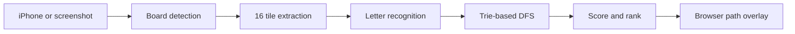

# WordLink Solver

**Find the highest-scoring words on a 4x4 Word Link board, from a screenshot or live iPhone screen.**

[](https://www.python.org/)
[](https://fastapi.tiangolo.com/)
[](https://opencv.org/)

WordLink Solver is a local Python app with a browser interface. It recognizes a 4x4 board from an uploaded screenshot or USB-connected iPhone, searches every valid word path, ranks the results, and draws the chosen path over the board.

## Run It

### Requirements

- Windows
- Python 3.10 or newer
- Git

### Install

```powershell
git clone https://github.com/arnavdedhia/WordLink.git
cd WordLink

py -3 -m venv .venv
.\.venv\Scripts\Activate.ps1
python -m pip install --upgrade pip
python -m pip install -r requirements.txt
```

If `py -3` is unavailable, create the environment with `python -m venv .venv` instead.

### Start the Web App

For uploaded or pasted screenshots and manual board entry:

```powershell
python -m word_solver.web --no-iphone --open
```

Open <http://127.0.0.1:8000> if a browser does not open automatically.

To test the included screenshot, visit the app and upload:

```text
word_solver\vision\samples\board_osye.jpg
```

## Example

The included screenshot contains:

```text
O S Y E
Y Y E M
O T P E
F U N D
```

<p align="center">
  
</p>

It recognizes the board, finds valid words, and recommends `DEPUTES` with a score of `1010`.
The browser shows the word's letter sequence as a numbered path over the 4x4 board.

You can:

- Upload, drag, or paste a screenshot
- Type or edit a board
- Confirm or correct uncertain letters
- Skip an alternative without blocking it
- Mark a word as rejected; it is saved to `word_solver/data/blocked_words.txt`
- Undo the latest rejection

## How It Works



The app locates and divides the board into 16 cells, isolates each letter, and compares the normalized glyph against real and synthetic letter templates.

A Trie stores the dictionary by prefix. DFS starts at every tile and follows adjacent or diagonal cells without reusing a tile. Each new cell must lead to a valid Trie prefix, so paths that cannot form a dictionary word are pruned immediately.

Words are ranked by:

1. Scrabble-style letter points
2. A length bonus
3. Longer words, then alphabetical order for ties

Rejection and skip actions work from the cached result list, avoiding repeated captures or solves.

## Optional: Live iPhone Capture

Live capture requires a USB data cable, an unlocked iPhone, Apple USB support on Windows, and the iPhone `Trust` prompt approved.

Check the connection:

```powershell
python -m word_solver.capture list
python -m word_solver.capture pair
python -m word_solver.capture prepare
python -m word_solver.capture doctor
```

Then run:

```powershell
python -m word_solver.web --open
```

Click **Watch iPhone** in the browser. The app captures read-only screenshots, waits for the board to stop changing, recognizes the new board, and updates recommendations automatically.

## Command-Line Solver

```powershell
# Solve a manually entered board
python -m word_solver --board OSYE YYEM OTPE FUND

# Solve the included screenshot
python -m word_solver --image word_solver/vision/samples/board_osye.jpg --debug
```

## Limitations

- Letter recognition uses templates rather than a trained OCR model.
- Board detection is tuned to the game's current 4x4 layout and may need adjustment for another screen layout.
- Live capture is Windows and USB/iPhone focused.
- The board geometry and recognition confidence can produce uncertain cells, which the app exposes for manual correction.
- No license file is currently included.

## License

No license is currently included. A license should be chosen before the repository is presented as open source.

## Credits

- [OpenCV](https://opencv.org/) for image processing
- [FastAPI](https://fastapi.tiangolo.com/) and [Uvicorn](https://www.uvicorn.org/) for the local web app
- [pymobiledevice3](https://github.com/doronz88/pymobiledevice3) for read-only iPhone USB capture
- ENABLE1 as the base dictionary, ranked with the OpenSubtitles 2018 FrequencyWords list
